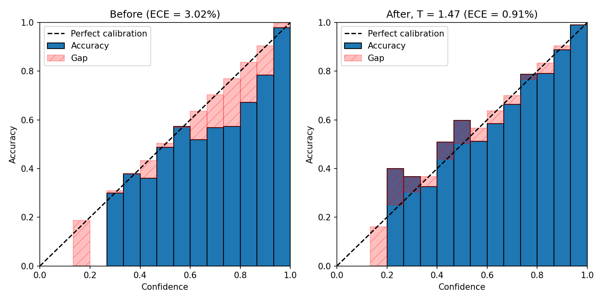
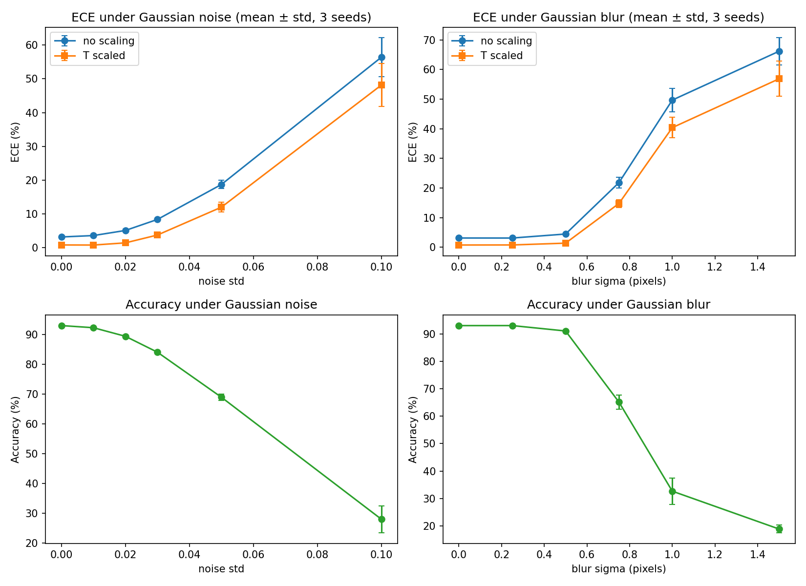

# calibration-reproduction
Reproducing "On Calibration of Modern Neural Networks" (Guo et al., 2017) on CIFAR-10, with an extension to distribution shift
# Calibration of modern neural networks: reproduction and extension

A reproduction of **"On Calibration of Modern Neural Networks"** (Guo, Pleiss, Sun, Weinberger, ICML 2017, [arXiv:1706.04599](https://arxiv.org/abs/1706.04599)) on CIFAR-10 with ResNet-18, plus an extension that asks whether temperature scaling still works when the test images are corrupted.

Author: Utkarsh Alagh, B.Tech Electrical Engineering, IIT Delhi.

## Question

A classifier reports a confidence with each prediction. The paper shows that modern networks are often *overconfident* (they claim more certainty than their accuracy justifies), and that rescaling the logits with a single temperature parameter fixes most of this without changing which class is predicted.

This project:

1. **Reproduces** that result: measure miscalibration with the Expected Calibration Error (ECE) and reliability diagrams, then apply temperature scaling.
2. **Extends** it: the temperature is fitted on clean validation images, so does it still give calibrated confidences when the test images are noisy or blurred?

## Results

### Reproduction (ResNet-18, CIFAR-10, mean ± std over 3 training seeds)

| | test accuracy | ECE | NLL |
|---|---|---|---|
| uncalibrated | 92.97 ± 0.11 % | 3.13 ± 0.13 % | 0.241 ± 0.006 |
| temperature scaled | 92.97 ± 0.11 % | 0.75 ± 0.14 % | 0.214 ± 0.003 |

The fitted temperature was 1.47, 1.50 and 1.47 for the three seeds, and predictions are unchanged by the scaling. The paper reports ECE of 3.28 to 4.6 % before and 0.33 to 0.83 % after temperature scaling for CIFAR-10 models (its Table 1, same 15-bin ECE and 45k / 5k / 10k split), so the qualitative result reproduces. The maximum calibration error (MCE) is reported in the notebook but is too noisy across seeds to support conclusions.

### Extension: calibration under distribution shift

The temperature fitted on clean data is applied unchanged to test images with Gaussian noise or Gaussian blur (mean over 3 seeds).

| corruption | level | accuracy | ECE, no scaling | ECE, temperature scaled |
|---|---|---|---|---|
| none | 0 | 92.97 % | 3.13 % | 0.75 % |
| noise | 0.02 | 89.38 % | 5.05 % | 1.38 % |
| noise | 0.05 | 68.93 % | 18.69 % | 11.96 % |
| blur | 0.50 | 91.02 % | 4.47 % | 1.38 % |
| blur | 1.00 | 32.68 % | 49.68 % | 40.38 % |

**Finding.** While the corruption is mild (accuracy within about 4 points of clean), temperature scaling keeps ECE near 1 %. As the images drift further and accuracy falls, most of the benefit disappears: a single scalar fitted on in-distribution data cannot absorb the shift.

## Repository contents

| path | contents |
|---|---|
| `calibration_reproduction.ipynb` | the full write-up: background, protocol, code, results, comparison with the paper, limitations |
| `figures/` | the figures shown above |
| `results/` | result tables as CSV (`repro_results.csv`, `shift_results_all_seeds.csv`) |

Model weights are not included (about 45 MB each). They can be regenerated by retraining, which takes about 20 to 25 minutes per seed on a free Colab GPU.

## How to run

1. Open the notebook in Google Colab (badge above) and select a GPU runtime.
2. In the setup cell, set `TRAIN = True`.
3. Run all cells. Trained models and outputs are saved to a Google Drive folder named `calib_project`.

With `TRAIN = False`, the notebook instead loads previously saved models and logits from that folder.

## Protocol in brief

- 45,000 training / 5,000 validation / 10,000 test images; the validation set is used only to fit the temperature.
- ResNet-18 with a 3x3 stride-1 first convolution and no max-pool; SGD with momentum, cosine learning rate, weight decay 5e-4, 30 epochs, crop and flip augmentation.
- ECE and MCE with 15 equal-width bins; NLL as a second metric.
- Three seeds (0, 1, 2); temperature fitted separately for each seed by a grid search on validation NLL.

## Limitations

One dataset and one architecture; only temperature scaling among the paper's methods; three seeds give rough spread estimates; the shift study uses two synthetic corruptions rather than the full CIFAR-10-C benchmark. The notebook discusses these and possible next steps in more detail.

## References

1. C. Guo, G. Pleiss, Y. Sun, K. Q. Weinberger. *On Calibration of Modern Neural Networks.* ICML 2017.
2. K. He, X. Zhang, S. Ren, J. Sun. *Deep Residual Learning for Image Recognition.* CVPR 2016.
3. A. Krizhevsky. *Learning Multiple Layers of Features from Tiny Images* (CIFAR-10), 2009.
